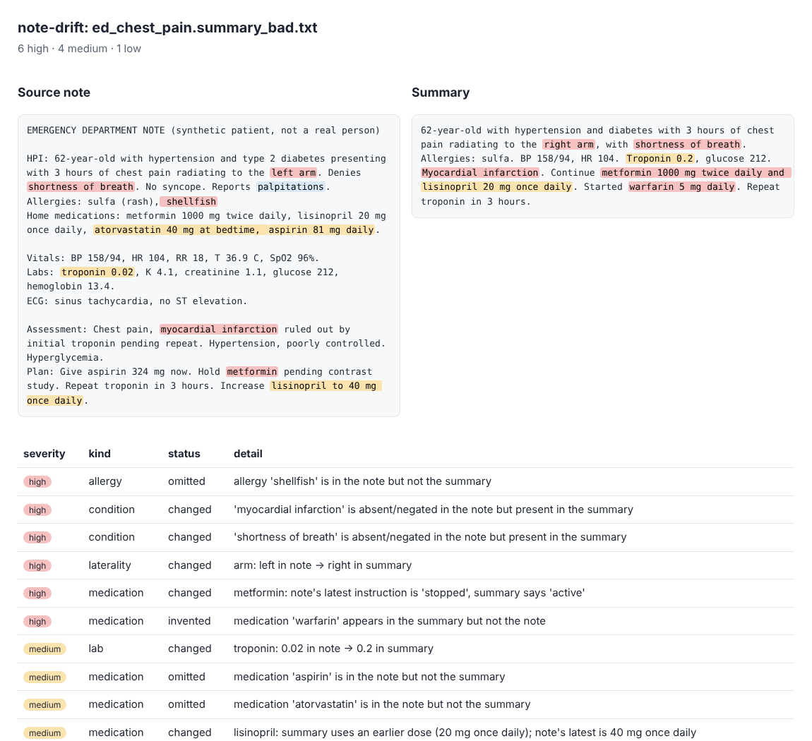

# note-drift

**Catch the facts that change when a clinical note gets summarized.**

AI scribes and summarizers are being rolled into clinics to write handoffs, discharge summaries and visit notes. The failure that matters is rarely a clumsy sentence. It is a dose that turns 20 mg into 200 mg, a "denies chest pain" that becomes "chest pain", a right ear that becomes a left ear, or an allergy that silently disappears.

`note-drift` compares a source note with its summary and flags every checkable fact that was **dropped, changed or invented**, ranked by how much it could hurt a patient. Every flag points at the exact text in both documents, so a reviewer can verify it in seconds.



*Synthetic patient. Left: source note. Right: a flawed summary. Red = high severity, amber = medium.*

## What it checks

| Fact type | Examples of what gets flagged |
|---|---|
| Allergies | allergy missing from the summary; "no known allergies" replacing a real allergy; **a drug the patient is allergic to appearing as an active medication** |
| Medications | dose changed (with g/mg/mcg normalization), frequency changed, drug invented, drug the note stopped shown as continued, summary using an outdated dose when the plan changed it |
| Conditions | negation flips (absent in note, present in summary, or the reverse) and invented diagnoses |
| Laterality | left/right swaps for body parts |
| Vitals and labs | changed values (temperature converted to °C first) |

Summaries are supposed to leave things out, so plain omissions of vitals, labs and negative findings are low or informational. Changed and invented facts are high.

## Quick start

```bash
pip install git+https://github.com/kishoren18-hue/note-drift
note-drift note.txt summary.txt --html report.html
```

```
[HIGH  ] allergy     changed          allergy to amoxicillin replaced by 'no known allergies'
[HIGH  ] condition   changed          'pneumonia' is absent/negated in the note but present in the summary
[HIGH  ] laterality  changed          ear: right in note -> left in summary
[HIGH  ] medication  allergy-conflict summary has the patient taking amoxicillin, but the note lists an allergy to amoxicillin
[HIGH  ] medication  changed          cefdinir: frequency twice daily -> once daily
[MEDIUM] medication  omitted          medication 'cetirizine' is in the note but not the summary
```

The command exits with status 1 when it finds anything at or above `--fail-on` (default `high`), so it can gate an automated summarization pipeline.

From Python:

```python
from note_drift import check
report = check(note_text, summary_text)
for f in report.findings:
    print(f.severity, f.detail)
```

## Benchmark (synthetic, small)

`benchmarks/run_benchmark.py` takes each faithful summary in `examples/notes/`, injects six kinds of known error (dose change, frequency change, left/right flip, negation flip, dropped allergy, invented drug), and checks whether a new medium/high finding of the right kind appears.

| | |
|---|---|
| note/summary pairs | 3 |
| injected errors | 18 |
| detected | 18 |
| medium/high false alarms on the faithful summaries | 0 |

Read this honestly: the notes were written alongside the rules, there are only three, and injected errors are cleaner than real ones. It shows the checks work as designed, not that the tool is accurate on real AI-generated summaries. The next step is evaluating on a larger set of synthetic records (for example, notes generated from [Synthea](https://synthetichealth.github.io/synthea/) patients) summarized by real models, with errors labeled by hand.

## How it works

1. **Extraction.** Transparent rules pull out allergies (including reactions), medications (dose, unit, frequency, PRN, stopped/completed status), vitals, labs, conditions with NegEx-style negation scoping, and laterality. Every fact keeps its character span.
2. **Comparison.** Facts are matched by type and name. For medications, the note's *latest* mention is used, since the plan usually comes after the home medication list. "Type 2 diabetes" and "diabetes" are treated as the same problem.
3. **Severity.** A fixed table ranks findings by patient-safety impact. It lives in `compare.py` and is easy to tune.

No model, no API calls, no dependencies. That keeps it auditable and fast enough to run on every generated summary.

## Limitations

* Rule-based extraction misses phrasings it hasn't seen. The drug list is about 100 common medications plus a fallback for any "<word> <dose> <unit>" pattern; swap in RxNorm for real use.
* It checks facts it can extract. It does not judge clinical reasoning, tone or completeness of the plan.
* Synthetic examples only. Never run real patient data through tools or services that aren't approved for it.
* **This is a screening aid, not a medical device.** A clinician must review every summary.

## Why I built this

During a summer clinical internship at a pediatric practice, part of my job was transcribing clinical notes. It made obvious how much a single misplaced word in a note can matter, and how hard those slips are to spot when you read a summary on its own. My research is on calibration and reliability in language models, including in clinical dialogue, and this is the practical end of that question: before trusting an AI-written summary, check what changed.

## Development

```bash
pip install -e ".[dev]"
pytest -q                         # 16 tests
python benchmarks/run_benchmark.py
```

## License

MIT
