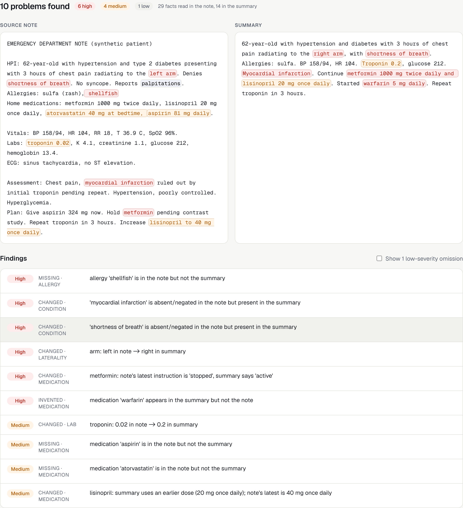

# note-drift web app

The hosted version of [note-drift](../README.md): paste a clinical note and its summary, or let Claude write the summary, and see every fact that was dropped, changed or invented, highlighted in both documents.



## Features

* **Paste mode.** Check any summary against its source note. No account needed, nothing stored.
* **Claude mode.** Claude writes the summary, then note-drift audits it.
  * *Faithful:* how close does a careful AI summary get?
  * *Challenge:* Claude secretly plants two errors; see whether note-drift catches them, then reveal what changed.
* **Side-by-side highlights.** Click a finding to jump to the exact words in both documents.
* **Saved reports.** Sign in with an emailed link to save, revisit, share (opt-in public link) and delete reports.
* **Safety rails.** Text that looks like it contains real identifiers (SSN, phone, MRN, date of birth, address, email) is never sent to the AI and can't be saved. AI use needs an account and has a daily limit.

## Architecture

```
Browser ─ Next.js 15 · React 19 · TypeScript · Tailwind CSS
   │
   ├── POST /api/py/check ──────► FastAPI (Python, Vercel function) ──► note_drift library
   ├── POST /api/py/summarize ──► FastAPI ──► Claude API
   │                                 └──► Supabase RPC nd_take_quota (per-user daily limit)
   └── reports (save / list / share / delete) ──► Supabase Postgres, row-level security
                                                  Supabase Auth (email magic link)
```

| Layer | Choice | Why |
|---|---|---|
| Frontend | Next.js App Router, TypeScript, Tailwind | Server components for data pages, client components for the checker |
| API | FastAPI on Vercel Python functions | The checker is a Python library; no reimplementation |
| Data | Supabase Postgres with RLS | Users see only their reports; public links are opt-in per report |
| Auth | Supabase magic link | No passwords to store or leak |
| AI | Claude via the official Python SDK | Model set by `CLAUDE_MODEL` |

### Security model

* Every table has row-level security. Users can read, edit and delete only their own reports, plus reports their owners made public. Inserts can't set another user's id.
* The AI quota lives in a table with no policies, reachable only through a `security definer` function that uses the caller's verified identity.
* The Anthropic key exists only as a server-side environment variable. The Supabase anon key is public by design; RLS enforces access.
* Security headers on every response (`X-Frame-Options`, `nosniff`, `Referrer-Policy`, `Permissions-Policy`).

`supabase/tests/rls_test.sql` checks these rules as different users (owner, other user, anonymous) and runs in CI against a real Postgres.

## Run locally

```bash
cd web
npm install
pip install -e .. fastapi httpx anthropic uvicorn
cp .env.example .env.local     # optional: add Supabase + Anthropic values
npm run dev                    # Next.js on :3000, FastAPI on :8000
```

Without environment variables, paste mode works and account/AI features show a "not configured" state.

## Tests

```bash
npm test              # unit tests (Vitest)
npm run test:api      # API tests (pytest, with fake Supabase and Claude)
npm run lint && npm run typecheck && npm run build
```

CI runs all of these plus the database security tests on every push (`.github/workflows/web.yml`).

## Deploy

1. Create a Supabase project and run `supabase/migrations/0001_note_drift.sql`.
2. Import the repository into Vercel with **Root Directory** set to `web`.
3. Set environment variables: `NEXT_PUBLIC_SUPABASE_URL`, `NEXT_PUBLIC_SUPABASE_ANON_KEY`, `SUPABASE_URL`, `SUPABASE_ANON_KEY`, `ANTHROPIC_API_KEY`, `NEXT_PUBLIC_SITE_URL`.
4. In Supabase → Authentication → URL configuration, add the site URL and `<site>/auth/callback` as redirect URLs.
